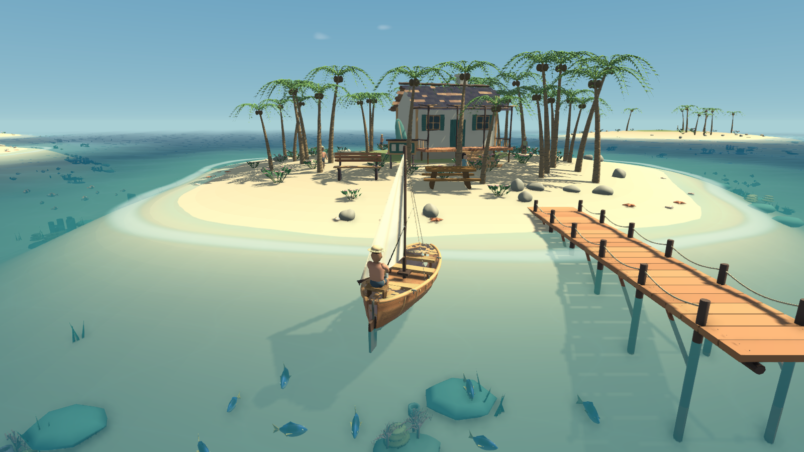
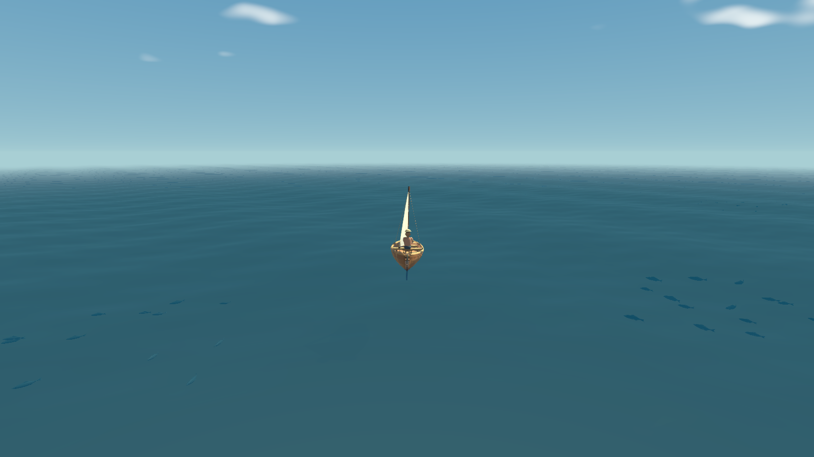

# 0.5.1 画面与空间逻辑修复

记录日期：2026-10-10，北京时间。

检查当前源码、实际 Windows 画面及已有完整自检后，修复下列问题。Blender 源模型仍为原有 34 套，地形和新增支撑由 Unity 在运行时生成。

| 问题 | 修复后的行为 |
| --- | --- |
| 珊瑚、海草悬在统一平面海床上方；地形采样与不规则岸线不一致 | 岸线、地形、碰撞器共享归一化高度，连续岸坡连接到外海海床；珊瑚、海草和礁石贴合本地海床，过浅位置过滤高珊瑚。 |
| 小屋抬高后底部缺少基座，门廊、楼梯及码头支柱没有接地 | 补齐小屋基座、门廊木柱与楼梯支撑；码头支柱延伸到海床，岸端位置调整到沙滩边缘。 |
| 320 米海面在远海完全雾化之前结束，出现直线色带 | 保留近处 1.25 米网格，添加逐渐变粗的外围网格；覆盖扩大到 640×640 米，共 82,433 个顶点，海面边缘位于完整雾化之外。 |
| 大型动物离场下潜可能穿过海床；固定间距不能覆盖尾部动作 | 按真实导入骨骼的 Swim / Glide 动作计算各物种底部范围，在符合水深的区域游动并保持海床间距；离场先渐隐再回收。 |
| 鲸鱼在呼吸孔还未出水时喷气，喷气位置偏离模型呼吸孔 | 使用模型呼吸孔位置，确认它高于该处实际水面后才喷气。 |
| 水下物件过于清晰，离水部位沿用全身水下染色 | 水下部分按逐像素水深吸收颜色；鱼和大型动物同步局部水面高度，离水部分不再套用整条鱼的水深。海床阴影随水深散射减弱。 |
| 新岸坡下的迁徙路径仍只检查岸距，鱼群会被浅水挡住 | 航道检查整群横向宽度、纵向偏移与水深；普通鱼、上钩鱼和迁徙鱼都遵守实际海床间距。 |

海床大平面的雾化改为逐像素计算，消除了新岸坡与外海平面之间的色块边界。海床采样先剔除远处岛屿，再计算局部岸坡高度。

## 验证

- Windows 0.5.1 最终构建成功，报告 146,800,965 字节；8 鱼种在 50 fps / 10 fps 时间步下的控线规则通过，34 套 Blender 模型、材质和动作导入检查通过。
- WebGL 0.5.1 最终构建成功，报告 68,379,289 字节；本机浏览器正常加载，实际 E 抛竿、Q 收竿、Y 天气切换、N 迁徙预告与迁徙鱼群显示通过，暂停画面与计时保持冻结。未观察到 error 日志。
- 最终完整原生自检退出码 0，报告 `VOYAGE_ENVIRONMENT_TESTS_PASSED`、`VOYAGE_RUNTIME_TESTS_PASSED` 和 `VOYAGE_FISHING_TESTS_PASSED`。
- 实际场景包含 153 处可见珊瑚，最低珊瑚顶部水深约 0.86 米；海草根部与海床高度一致，普通鱼和迁徙鱼保持至少约 0.45 米的中心海床间距。
- 实际骨骼测得游泳动作底部范围：鲸鱼 -1.279 米、鲨鱼 -0.480 米、海豚 -0.681 米；预留额外 0.16 米。另用不同动作相位烘焙完整蒙皮验证海床间距，海豚跃出后的加速度符合 9.81 米/秒²，鲸鱼喷气时呼吸孔位于水面上方。
- 迁徙实际在 2 秒内连续移动约 3.601 米；真实控线搏鱼约 11.50 秒，最大手柄约束误差输出为 0.0000 米，起鱼仅入账一次。驾驶、倒航、转向、浮力、船帆、相机、暂停、小地图、雷暴、涌浪和荧光海检查通过。
- 最终 Windows 实景截图已更新：`Day.png`、`Cottage.png`、`Offshore.png`、`Fishing.png`、`Storm.png`、`Luminous.png`、`Migration.png` 和 `IslandVoyage.png`，均位于 `Screenshots/`。

浏览器仍记录原有 URP `Blit FSR Upscaling` 初始化警告。核对本机 URP 源码，该无效 FSR 通道会被跳过；当前渲染比例为 1，未启用 FSR，不影响此次海床、海面与物件修复。网页检查截图为 `Screenshots/Web-Environment.jpg`。

构建和运行详细日志保存在本机被忽略的 `Tools/Logs/Windows.log`、`Tools/Logs/Web.log`、`Tools/Logs/Runtime.log`，规则报告在 `IslandVoyage/Builds/RuleValidation.txt`。

## 复现检查

```powershell
.\Tools\Invoke-Unity.ps1 -Task Windows
.\Tools\Test-Voyage.ps1
.\Tools\Preview-Voyage.ps1 -Scene Cottage
.\Tools\Preview-Voyage.ps1 -Scene Offshore
.\Tools\Invoke-Unity.ps1 -Task Web
```




