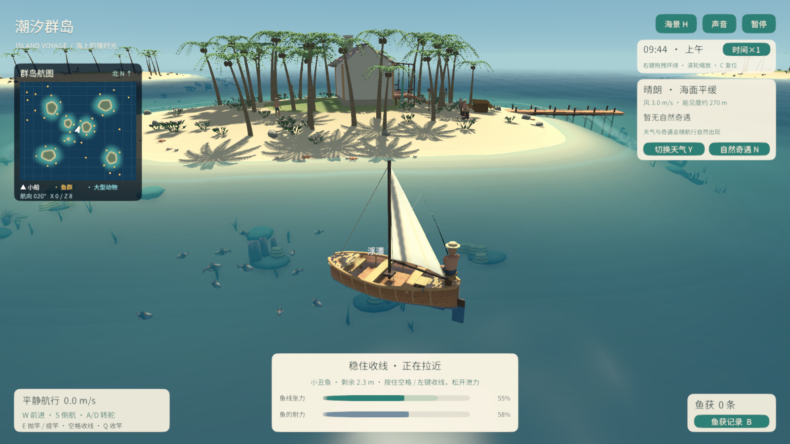

# 潮汐群岛 · Island Voyage

海岛航行小游戏。驾驶小帆船探索群岛，在鱼群旁停船抛竿，观察天气、昼夜与海上自然奇遇。

当前版本：**0.5.0**。包含可编辑 Unity 工程、Blender 美术源文件、构建工具和开发记录。



## 游戏内容

- 520×440 米可航行海域、7 座岛屿、40 群普通鱼，鲸鱼、鲨鱼和海豚低频出现。
- 近景第三人称镜头，鼠标右键环绕、滚轮缩放，以及实时群岛小地图。
- 抛竿、等口、提竿、收放线和起鱼；八种鱼有不同的冲刺、难度与重量范围。
- 坐姿钓手、双臂骨骼 IK、受力弯曲鱼竿、鱼线与随浪浮动的浮漂。普通鱼分层游动，颜色随水深衰减。
- 五类天气、昼夜循环、鱼群迁徙、异常涌浪与夜间荧光海。
- 船体四点浮力、海浪与航行尾流；岛上居民行走，海洋动物使用骨骼游泳动作。

## 打开工程

1. 克隆仓库：

   ```powershell
   git clone https://github.com/tomton1010/island-voyage.git
   ```

2. 通过 Unity Hub 安装 **Unity 6000.6.3f1**。网页版构建还需安装对应的 Web Build Support 模块。
3. 在 Hub 添加仓库中的 **`IslandVoyage` 子目录**，等待资源和依赖导入；工程使用 URP 17.6.0。
4. 打开 `Assets/Scenes/IslandVoyage.unity`，点击 Play。场景内容在运行时生成；需要重建设置时使用 `Tools > Island Voyage > Prepare Project`。

编辑 Blender 源文件可使用 Blender 5.2 LTS；仅运行 Unity 工程不需要安装 Blender。

## 操作

| 按键 | 操作 |
| --- | --- |
| W / S | 沿船头前进 / 沿船尾倒航 |
| A / D | 左 / 右转舵 |
| Shift | 慢行辅助 |
| E | 低速靠近平静鱼群后抛竿；浮漂明显下沉、提示咬钩时再按 E 提竿 |
| 空格 / 鼠标左键 | 上钩后按住收线，松开泄力；未钓鱼时左键点击可驱散鱼群 |
| Q | 收竿取消 |
| 鼠标右键拖动 / 滚轮 | 环绕镜头 / 缩放 |
| C | 恢复默认镜头 |
| Y / N / T | 切换天气 / 体验自然奇遇 / 改变昼夜流速 |
| B / P / H | 鱼获记录 / 暂停 / 隐藏界面 |

保持合适的鱼线张力，避免断线或脱钩；鱼耐力耗尽并被拉近后自动起鱼。鱼获数量和最大重量目前保存在本次运行。

## 构建和验证

Unity 菜单 `Tools > Island Voyage` 提供 Windows、Web 和规则验证入口。仓库根目录也提供 PowerShell 工具；使用前将 `Tools/Invoke-Unity.ps1` 中的 Editor 路径调整到自己的安装位置：

```powershell
.\Tools\Invoke-Unity.ps1 -Task Windows
.\Tools\Invoke-Unity.ps1 -Task Web
.\Tools\Test-Voyage.ps1
```

Windows 构建输出至 `IslandVoyage/Builds/Windows/`。Web 构建完成后，可在仓库根目录运行 `python .\Tools\serve-web.py`，再打开 `http://127.0.0.1:8765/`。构建包、Unity 缓存、下载文件与本地日志通过 `.gitignore` 排除。

0.5.0 已通过 Windows / WebGL 构建、八种鱼的控线规则检查，以及真实场景中的完整钓鱼、骨骼约束、鱼群深度、驾驶、相机、天气与事件运行检查。完整记录见 [开发进度](开发进度.md)。

## 工程目录

| 目录 | 内容 |
| --- | --- |
| `IslandVoyage/` | Unity 工程、代码、材质、模型导入文件与配置 |
| `ArtSource/` | 34 套可编辑 Blender 资源、制作说明和资源报告 |
| `Tools/` | 构建、实际运行检查、预览及 Blender 生成工具 |
| `Screenshots/` | 实际游戏场景截图与动画预览 |
| `Docs/` | 历次开发进度快照 |

详细操作与参数见 [Unity 工程说明](IslandVoyage/README.md)，模型编辑与再生成见 [美术源文件说明](ArtSource/README.md)。

模型、程序材质、钓具、基础音效和界面由本项目制作；中文字体为 Noto Sans CJK SC，随附 [SIL Open Font License](IslandVoyage/Assets/Resources/Fonts/OFL.txt)。物理和动画使用实时游戏近似；当前尚未实现跨次存档、完整流体或绳索碰撞求解。
